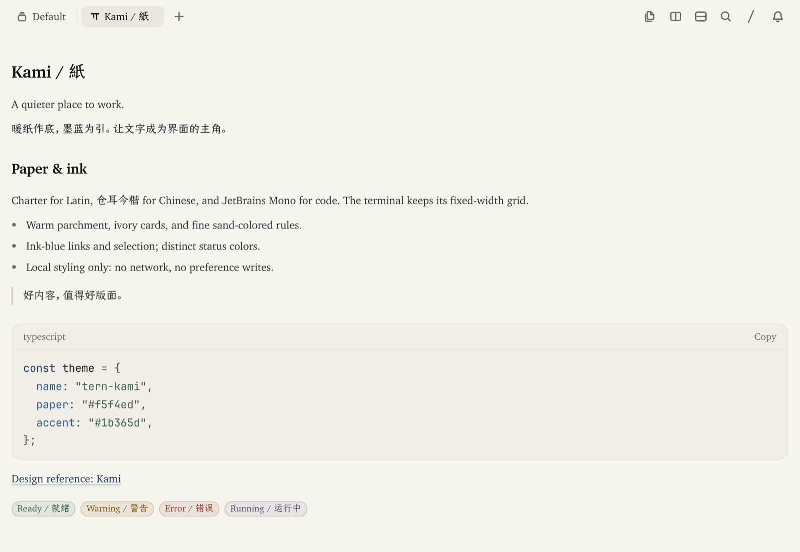

# Tern Kami

A warm-paper theme for [Tern](https://stencil.so/tern), inspired by [Kami](https://kami.tw93.fun/) by Tw93.

暖纸底色、墨蓝强调色、衬线字体。将 Kami 的纸面风格带进 Tern。



Native Tern rendering with synthetic demonstration content, not a live agent conversation.
截图由 Tern 原生渲染，内容为排版演示，不是真实会话。

## Install / 安装

```sh
tern plugin install https://github.com/justdoswift/tern-kami
```

The theme applies when the plugin loads, including one-time font setup through Tern's native settings API. It is a **plugin**, not an entry in Tern's built-in theme picker. If a window has not refreshed, run `tern plugin reload` or reopen it. Requires Tern's window-plugin, CSS, and `cx.settings` APIs; verified on **Tern 0.8.4, macOS**. Windows, Linux, and iOS have not been tested.

安装后随插件加载生效，并通过 Tern 原生设置接口完成一次字体配置。这是**主题插件**，不是内置主题列表中的一个选项。窗口未刷新时，运行 `tern plugin reload` 或重新打开窗口。需要窗口插件、CSS 和 `cx.settings` 接口；已在 **macOS / Tern 0.8.4** 验证，Windows、Linux、iOS 尚未验证。

For a local checkout / 本地开发：

```sh
git clone https://github.com/justdoswift/tern-kami
tern plugin link ./tern-kami
```

## Typography / 字体

| Surface / 位置 | Font / 字体 |
| --- | --- |
| Interface and Latin prose / 界面与西文正文 | Charter → Georgia → serif |
| Chinese prose / 中文正文 | TsangerJinKai02（仓耳今楷 02）→ Source Han / Noto Serif → Songti SC |
| Code, inline code, monospace status text, and terminal / 代码、行内代码、等宽状态文字及终端 | JetBrains Mono → Fira Code → system monospace |

Install the fonts locally, then restart Tern. Charter ships with macOS. Get 仓耳今楷 from [Tsanger](https://tsanger.cn/) and [JetBrains Mono from JetBrains](https://www.jetbrains.com/lp/mono/); follow each font's own license. Font binaries are not distributed by this repository. Missing fonts fall back through the stacks above.

先在系统中安装字体，再重启 Tern。macOS 自带 Charter；仓耳今楷请从[仓耳字库](https://tsanger.cn/)获取，JetBrains Mono 请从[官网](https://www.jetbrains.com/lp/mono/)获取，并遵守各自的字体授权。仓库不分发字体文件；缺失字体时使用上表中的后备字体。

**Automatic font setup:** On first load, the plugin saves the previous six font-family preferences, then atomically sets **Font** and **Code font** to the JetBrains Mono stack and **UI font** to the Charter/仓耳今楷 stack. Bold, italic, and bold-italic overrides are cleared to use the selected terminal family's own faces. Font sizes and weights are unchanged. The native API recalculates terminal cells and cursor metrics; the plugin never overrides `--tv-font` in CSS.

**自动配置字体：** 首次加载时，插件先保存原有的六项字体族设置，再一次性将 **Font**、**Code font** 设为 JetBrains Mono 字体栈，将 **UI font** 设为 Charter／仓耳今楷字体栈。粗体、斜体和粗斜体的独立覆盖清空，改用所选终端字体自身的字形。不改字号和字重。原生接口会重新计算字符网格和光标尺寸，插件不通过 CSS 覆盖 `--tv-font`。

Setup runs only once while the plugin's data is retained. Reloads, restarts, and upgrades do not reset later manual choices. The command palette offers **Apply Kami fonts / 应用 Kami 字体** to apply them again, and **Restore previous fonts / 恢复原字体** to undo the saved settings. Restore only changes fields still matching the plugin's values, preserving your later manual changes. A new apply after restoration saves the then-current fonts.

保留插件数据期间，自动配置只执行一次，重载、重启和升级不会重置你之后手动选择的字体。命令面板提供 **Apply Kami fonts / 应用 Kami 字体**，可再次应用；**Restore previous fonts / 恢复原字体** 可恢复保存的设置，只还原仍与插件设置一致的字段，保留你之后的手动更改。恢复后再次应用，会保存当时的新字体设置。

Tern currently parses but ignores CSS `@font-face`, so bundling a webfont would not install it. [Native CSS support](https://docs.stencil.so/tern/styles/css.html#font-face).

Tern 目前会解析但忽略 CSS `@font-face`，插件无法通过网页字体自动安装字体。

Tool-card code, diffs, ANSI output, and header file paths render at 90% of their configured size to balance JetBrains Mono with the surrounding prose. This does not change native font preferences, prose, standalone code blocks, tool names or controls, or Session headings.

工具卡片中的代码、差异、ANSI 输出及标题中的文件路径按原字号的 90% 显示，使 JetBrains Mono 与周围正文更协调。不改原生字体偏好、正文、独立代码块、工具名称和操作控件，也不调整 Session 标题。

Background-job/process status notices, full timestamp/usage rows, and full Todo lists also use 90% text sizing, with Todo notes kept smaller than task text. Already-compact usage rows, status colors, icons, disclosure targets, and the compact Todo HUD retain their native behavior.

后台任务／进程状态提示、完整时间与用量统计行、完整 Todo 列表的文字同样按 90% 显示，Todo 备注保持比任务正文更小。原本紧凑的统计行、状态颜色、图标、折叠操作区域及紧凑 Todo 浮条保留原生行为。

## Palette / 配色

| Token / 用途 | Color |
| --- | --- |
| Paper / 暖纸 | `#f5f4ed` |
| Ivory / 象牙白 | `#faf9f5` |
| Sand / 细线与衬底 | `#e8e6dc` |
| Sidebar / 左侧导航底色 | `#eeece2` |
| Selected tab / 已选中标签底色 | `#dce2e7` |
| Code / 代码背景 | `#f0eee6` |
| Ink / 正文 | `#141413` |
| Blue / 墨蓝 | `#1b365d` |
| Secondary blue / 次级蓝 | `#2d5a8a` |
| Muted / 次要文字 | `#6b6a64` |

The core colors and font stacks come from [Kami's stylesheet](https://kami.tw93.fun/styles.css). Primary buttons, loading indicators, progress, headings, emphasized text, links, tool titles, and model/thinking labels use ink blue. The sidebar uses a slightly deeper warm paper; selected tabs add a blue-gray fill, ink-blue edge, and stronger text. Hover stays distinct from selection.

基础颜色和字体栈取自 [Kami 样式表](https://kami.tw93.fun/styles.css)。主按钮、加载与进度、标题、重点文字、链接、工具标题及模型／思考标签统一使用墨蓝。左侧导航采用略深的暖纸色；选中标签增加浅蓝灰底、墨蓝侧线和加粗文字，悬停态与选中态保持区分。

These accent channels take precedence over a program's surface palette. Ordinary prose, explicit success/warning/error colors, syntax colors, and inline RGB/true-color output retain their own colors. Terminal ANSI and theme-driven semantic colors have Kami-compatible defaults.

上述强调色优先于程序的 Surface 调色板。普通正文、明确的成功／警告／错误颜色、代码语法色和直接输出的 RGB 真彩色仍保留自身配色；终端 ANSI 和跟随主题的语义色使用与 Kami 协调的默认值。

## Behavior / 使用边界

- **Light only.** Kami stays paper-colored even when the system appearance is dark. Disable it before using another theme.
- Styles native Tern chrome, Markdown surfaces, theme-driven code colors, and terminal ANSI colors. It does not inject CSS into browser blocks or websites.
- Working-text shimmer uses deep ink-blue text with a brighter blue sweep. The highlight remains readable on paper and card backgrounds; native animation timing and reduced-motion behavior are preserved.
- Installed on the local window side only. Installing it on a remote SSH host does not theme connected clients. Tern's Web client does not execute window plugins.
- No dependencies, network requests, shell commands, or recurring timers. One deferred load callback performs font setup when needed, including an upgrade in an already-open window. The plugin installs one stylesheet and stores a font-preference backup in its local `tern.kv` data; only font-family preferences are written.
- Existing layout, keyboard shortcuts, terminal font size, and focus behavior remain under Tern's control. Avoid enabling multiple global theme plugins together.

- **仅浅色。** 系统为深色时也保持纸面配色；切换其他主题前请停用本插件。
- 覆盖原生界面、Markdown、跟随主题的代码高亮及终端 ANSI 配色；不向浏览器面板或网页注入样式。
- 工作状态文字采用更深的墨蓝底色与更亮的蓝色扫光，高亮在纸面与卡片底色上仍清晰可读；保留原生动画速度和减少动态效果行为。
- 只在本机窗口端生效。安装到远程 SSH 主机不会改变连接客户端的主题；Tern Web 客户端不运行窗口插件。
- 零依赖，不联网、不执行外部命令、不设循环定时器。加载后通过一次性回调按需配置字体，也支持已打开窗口中的插件升级。插件注册一个样式表，并通过本地 `tern.kv` 保存字体设置备份；只写入字体族偏好，不改其他设置。
- 保留 Tern 的布局、快捷键、终端字号和焦点行为。请勿同时启用多个全局主题插件。

## Disable, remove, update / 停用、卸载、更新

To restore the original fonts as well, run **Restore previous fonts / 恢复原字体** from the command palette **before** disabling or removing Kami. Then turn it off in **Settings → Plugins** to remove its CSS and return to your saved Tern theme. Disabling/removing the plugin alone leaves the native font preferences in place. To remove an installed copy:

如需同时恢复原字体，请在停用或卸载 Kami **之前**，先从命令面板运行 **Restore previous fonts / 恢复原字体**。再到 **Settings → Plugins** 关闭 Kami，移除样式并恢复原有主题。仅停用或卸载插件不会撤回已经保存的原生字体设置。卸载安装副本：

```sh
tern plugin remove tern-kami
```

For a linked checkout, unlink instead; the source directory is kept / 本地链接使用 unlink，不删除源码目录：

```sh
tern plugin unlink tern-kami
```

Update an installed copy / 更新安装副本：

```sh
tern plugin install https://github.com/justdoswift/tern-kami --force
```

`--force` does not replace a linked checkout. Update that checkout yourself, then run `tern plugin reload`.

`--force` 不覆盖本地链接。请自行更新源码，再运行 `tern plugin reload`。

## Development / 开发

Edit `kami.css`, then reload with `tern plugin reload`. `window.luau` installs it as `plugin:local:tern-kami:theme`; Tern removes the sheet when the plugin unloads. No build step is needed.

修改 `kami.css` 后运行 `tern plugin reload`。样式表名为 `plugin:local:tern-kami:theme`，卸载插件时由 Tern 移除，无需构建。

Use a separate `TERN_CONFIG_DIR` and `TERN_DAEMON_SOCKET` for testing. Native plugin loading requires an ordinary Tern window: `tern serve` deliberately skips user plugins. A headless CSS preview can load the file with `tern ctl --control SOCKET css kami /absolute/path/to/kami.css`.

测试时使用独立的 `TERN_CONFIG_DIR` 与 `TERN_DAEMON_SOCKET`。真实插件加载应通过普通 Tern 窗口验证，`tern serve` 有意不加载用户插件；无窗口样式预览可通过上述 `tern ctl … css` 命令加载样式表。

Native rendering checks cover primary-button hover, tab hover and selection changes, conflicting program accent palettes, preserved semantic colors, light/dark host appearance, reduced motion/increased contrast, and a 760 × 560 compact window.

已通过原生渲染检查主按钮悬停、标签悬停与选中切换、程序强调色覆盖、语义色保留、宿主浅色／深色外观、减少动态效果／增强对比度及 760 × 560 紧凑窗口。

Font checks use a separate native window and cover first-load and existing-window upgrade setup, regular/bold/italic/bold-italic terminal faces, grid alignment, Markdown inline/fenced code, code blocks, diffs, and code/mono/key spans. Repeated apply preserves the original backup; manual choices survive reload; restoration and a subsequent apply/restore survive restart.

字体检查在隔离原生窗口中完成，覆盖首次自动配置、已打开窗口中的插件升级、终端常规／粗体／斜体／粗斜体、网格对齐、Markdown 行内与围栏代码、代码块、差异视图及 code／mono／key 文本。重复应用保留最初备份，手动选择不被重载覆盖；恢复、重启和再次应用／恢复均已验证。

Tool-content sizing is checked in the native renderer with mixed Chinese/English output, aligned columns, first/last-line previews, expand/collapse, scrolling to the final line, text selection, and compact-window wrapping. Status notices and full Todo lists cover long-text wrapping, with Todo disclosure checked by mouse and keyboard. Tool-header paths and full usage rows cover narrow-window ellipsis/wrapping and mouse/keyboard disclosure; native tool-name, compact-usage, and standalone-code sizes remain unchanged.

工具内容字号通过原生渲染验证，覆盖中英文混排、列对齐、首尾预览、展开／折叠、滚动至末行、文字选取及窄窗口换行。状态提示与完整 Todo 列表覆盖长文本换行，Todo 折叠展开同时验证鼠标和键盘操作。工具标题路径与完整统计行验证了窄窗口省略／换行及鼠标／键盘折叠操作；工具名称、紧凑统计行与独立代码块的原生字号保持不变。

## Credits & license / 致谢与许可

[MIT](LICENSE). Independent community theme; not an official Kami or Tern product. Kami's palette and font-stack attribution is retained in the license. Fonts remain under their respective licenses.

采用 [MIT](LICENSE) 开源协议。独立社区主题，非 Kami 或 Tern 官方产品；保留 Kami 配色及字体栈的署名。字体各自的授权不受本仓库 MIT 协议替代。
